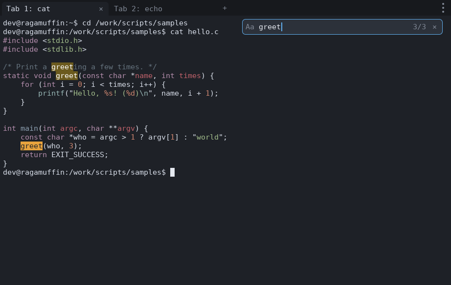
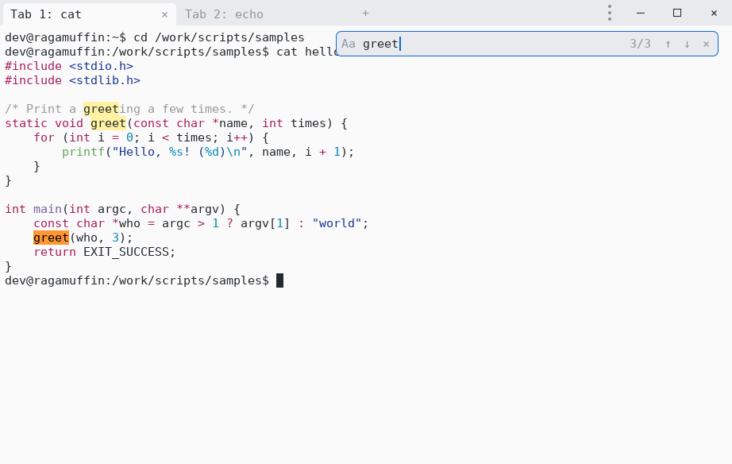
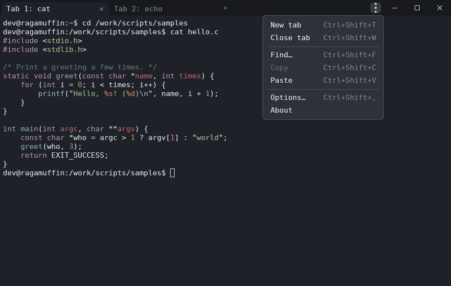
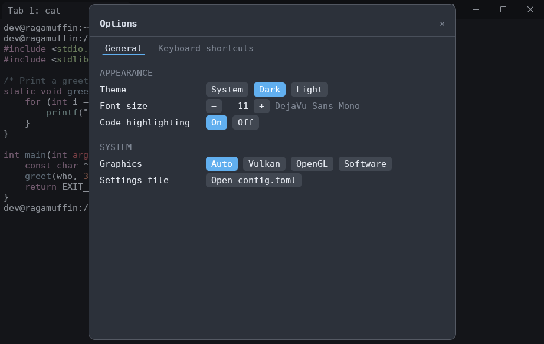

# ragamuffin

[](https://github.com/andrewpushkin/ragamuffin/actions/workflows/build.yml)

Ultra fast GPU-accelerated terminal emulator, written in Rust, for Linux,
Windows and macOS.

## Download

| Platform | Latest build |
|---|---|
| Windows x86-64 | [ragamuffin-windows-x86_64.zip](https://github.com/andrewpushkin/ragamuffin/releases/latest/download/ragamuffin-windows-x86_64.zip) |
| Windows ARM64 | [ragamuffin-windows-arm64.zip](https://github.com/andrewpushkin/ragamuffin/releases/latest/download/ragamuffin-windows-arm64.zip) |
| macOS Apple Silicon | [ragamuffin-macos-arm64.zip](https://github.com/andrewpushkin/ragamuffin/releases/latest/download/ragamuffin-macos-arm64.zip) |
| Linux x86-64: Debian, Ubuntu | [ragamuffin-linux-x86_64.deb](https://github.com/andrewpushkin/ragamuffin/releases/latest/download/ragamuffin-linux-x86_64.deb) |
| Linux x86-64: any distro | [ragamuffin-linux-x86_64.AppImage](https://github.com/andrewpushkin/ragamuffin/releases/latest/download/ragamuffin-linux-x86_64.AppImage) |

Every push to `main` is built by GitHub Actions and published as a
release, numbered `0.1.<commits on main>`. Older builds:
[all releases](https://github.com/andrewpushkin/ragamuffin/releases). Install notes are [below](#install).

| Dark | Light |
|---|---|
|  |  |

| ⋮ menu | Options |
|---|---|
|  |  |

- **GPU rendering** with [wgpu] (Vulkan, Metal, DirectX 12, OpenGL): one draw
  call per frame, glyphs cached in a texture atlas, redraws only when something
  changed.
- **Search highlighting like Notepad++ or Konsole**: every match on screen is
  marked, the current one stands out, and `3/17` shows where you are in the
  whole scrollback.
- **Code highlighting**: `cat hello.c`, `head main.rs`, `bat`, `type`
  (Windows), `Get-Content` (PowerShell) and `git diff` output is detected and
  coloured. The language comes from the file name, or from the content (`#!`
  lines, `#include`, `fn main`...) when there is no extension. Text a program
  colours itself is never touched.
- **Tabs** labelled with the last program run in them (`Tab 1: vim`), each
  with its own shell, scrollback and search. With many tabs the labels
  shorten to `1: vim`, then just the number.
- **One-line title bar**: minimize, maximize and close sit in the tab bar
  next to ⋮ (on macOS the native buttons move into it). Drag the empty part
  of the bar to move the window; double-click it to maximize.
- **⋮ menu** for tabs, find, copy and paste, Options and About, plus a
  right-click menu for copy, paste and select all.
- **Options panel** with two pages: General (theme, font size, code
  highlighting, graphics API) and Keyboard shortcuts. Drag its title to
  move it. Changes are saved to the settings file.
- **Light and dark themes** that follow the operating system automatically,
  including on Linux desktops (GNOME, KDE and others) and under WSL, or a
  fixed choice.
- **Settings file**: font, size, theme, shell, opacity and more. Saved changes
  apply immediately.
- **Quiet UI**: the scrollbar and search bar sit at 40 % opacity and become
  fully visible while you use them.
- **No `unsafe`** in ragamuffin's own code (`#![forbid(unsafe_code)]`).

## Install

- `.deb`: `sudo apt install ./ragamuffin-linux-x86_64.deb`
- AppImage: `chmod +x ragamuffin-linux-x86_64.AppImage && ./ragamuffin-linux-x86_64.AppImage`
- Windows: unzip and run `ragamuffin.exe` (Windows 10 1809 or newer).
- macOS: unzip and move `Ragamuffin.app` to Applications. The app is ad-hoc
  signed, not notarized, so the first launch needs right-click → Open.

Linux builds target glibc 2.31, so they run on Ubuntu 20.04, Debian 11,
Fedora 32 and anything newer.

## Shortcuts

On macOS, use Cmd where the table says Ctrl+Shift. The Options panel (⋮ →
Options… → Keyboard shortcuts) shows the same list.

| Keys                        | Action                                   |
|-----------------------------|------------------------------------------|
| Ctrl+Shift+T / Ctrl+Shift+W | new tab / close tab                      |
| Ctrl+Tab, Ctrl+PgDn         | next tab (with Shift, or PgUp: previous) |
| Ctrl+Shift+,                | Options                                  |
| Ctrl+Shift+F                | open or focus search                     |
| Enter / Shift+Enter, F3     | previous (older) / next match            |
| ↑ / ↓ in search             | previous / next match                    |
| Ctrl+R in search            | toggle regular expressions               |
| Esc in search               | close search                             |
| Ctrl+Shift+C / Ctrl+Shift+V | copy / paste                             |
| Ctrl+= / Ctrl+- / Ctrl+0    | larger / smaller / default font          |
| Ctrl+Shift+L                | cycle theme: system → dark → light       |
| Shift+PgUp / PgDn / Home / End | scroll the scrollback                 |

Mouse: drag to select, double-click selects a word, triple-click a line,
right-click opens the copy/paste menu, and middle-click pastes. On the tab
bar, middle-click closes a tab. Drag the scrollbar, or click the track to page. Hold
Shift to select text in programs that capture the mouse (vim, htop).

Search ignores case unless the query contains a capital letter.

## Settings

The settings file is created on first start:

- Linux: `~/.config/ragamuffin/config.toml`
- macOS: `~/Library/Application Support/ragamuffin/config.toml`
- Windows: `%APPDATA%\ragamuffin\config.toml`

Set `RAGAMUFFIN_CONFIG` to use a different file.

```toml
font_family = "JetBrains Mono"   # any installed font
font_size = 11.0                 # points
line_height = 1.2
theme = "system"                 # "system" | "dark" | "light"
shell = ""                       # empty: $SHELL, or PowerShell/cmd on Windows
shell_args = []
scrollback = 10000
ui_idle_opacity = 0.4            # scrollbar/search bar opacity when idle
padding = 6.0
code_highlight = true
code_theme_dark = "base16-ocean.dark"
code_theme_light = "InspiredGitHub"
bold_is_bright = false
title_bar = "custom"             # "custom" (buttons in the tab bar) | "system" (OS title bar)
display_backend = "auto"         # Linux: "auto" | "wayland" | "x11" (restart to apply)
antialiasing = "auto"            # "auto" | "subpixel" | "grayscale"
minimum_contrast = 4.5           # text on coloured backgrounds: WCAG contrast ratio, 1 = off
gpu = "auto"                     # "auto" | "directx" | "vulkan" | "opengl" | "metal" | "software"
```

**Graphics API.** `gpu` picks what draws the window (Options → General →
Graphics); it takes effect when ragamuffin restarts. `software` draws on
the CPU (Microsoft Basic Render Driver on Windows, llvmpipe on Linux), for
machines without a working GPU driver, remote desktops and VMs. If the
chosen API isn't available, ragamuffin falls back to the automatic choice
and starts anyway; About shows what is in use. For one run only:

```sh
ragamuffin --gpu software
ragamuffin --gpu opengl new-tab logs -- tail -f app.log
```

**Text on Windows** is drawn by DirectWrite, like in other Windows apps.
With `antialiasing = "auto"` it follows the system setting: ClearType
(sub-pixel) when "Adjust ClearType text" is on, as in Explorer and
Notepad; grayscale otherwise, as in Windows Terminal's default.
Box-drawing and block characters are drawn to fill the cell, so borders
and bars join between lines.

**WSL note:** on WSLg (Linux GUI apps on Windows), the mouse cursor may stay
hidden over a Linux window until you click it. That is WSLg behaviour and
affects other Linux apps too (e.g. `xeyes`). On Windows, the native Windows
build doesn't have this problem.

Code themes: `base16-ocean.dark`, `base16-eighties.dark`, `base16-mocha.dark`,
`base16-ocean.light`, `InspiredGitHub`, `Solarized (dark)`, `Solarized (light)`.

## Command line

The same `ragamuffin` program controls a window that is already open:

```text
ragamuffin [--gpu API]
ragamuffin [--pid N] new-tab [NAME] [-- COMMAND ARGS...]
ragamuffin [--pid N] close-tab [NAME | NUMBER]
ragamuffin [--pid N] quit
ragamuffin --help
```

| Command | What it does |
|---|---|
| `new-tab` | Opens a tab with your shell. If no window is running, starts one. |
| `new-tab NAME` | The tab's label reads `Tab N: NAME` instead of the program name. |
| `new-tab NAME -- COMMAND ARGS...` | Runs `COMMAND` in the tab instead of the shell; the tab closes when it exits. |
| `close-tab` | Closes the active tab. |
| `close-tab NAME` | Closes the tab with that name (or, failing that, running that program). |
| `close-tab 2` | Closes the second tab. |
| `quit` | Closes the window and all its tabs. |

Examples:

```sh
ragamuffin new-tab logs -- tail -f /var/log/syslog
ragamuffin new-tab build -- cargo watch -x test
ragamuffin close-tab logs
```

```powershell
ragamuffin new-tab dev -- powershell -NoExit -Command "cd C:\src\app"
ragamuffin new-tab cmd -- cmd /k echo hello
```

**Which window.** Commands go to the most recently started window.
`--pid N` picks one by process id (`ragamuffin --pid 1234 quit`).

**Replies and exit codes.** A command prints a short reply (`opened tab
2`, `closed Tab 1: logs`) and exits with 0; errors (`no tab named x`,
`no window is running`) exit with 1, bad usage with 2.

**Windows.** `ragamuffin.exe` is a GUI program, so cmd and PowerShell
don't wait for it: the reply appears, but after the prompt. To wait for
it and read `$LASTEXITCODE` in a PowerShell script, pipe its output:

```powershell
ragamuffin quit 2>&1 | Out-Host
if ($LASTEXITCODE -ne 0) { "no window to close" }
```

From WSL it behaves like any Linux command.

**How it works.** Each window listens on a random port on 127.0.0.1 and
writes the port and a random secret to `instances/<pid>` in the local
data directory (`%LOCALAPPDATA%\ragamuffin` on Windows,
`~/.local/share/ragamuffin` on Linux, `~/Library/Application
Support/ragamuffin` on macOS), readable only by you. A command must
present that secret. The file is removed when the window closes.

## Building

Everything builds in Docker, so the only requirements are Docker and `make`.
Each platform has its own image in `docker/`. All generated files are normal
files in the project, owned by your user: packages in `dist/`, build output
in `target/`, downloaded crates in `.cache/`. `make clean` is a plain
`rm -rf target dist` and needs no Docker.

```sh
make all                     # every release package below

make linux-x86_64            # compile only
make linux-x86_64-deb        # .deb
make linux-x86_64-appimage   # AppImage
make windows-x86_64          # compile only
make windows-x86_64-zip      # zip
make windows-arm64           # compile only
make windows-arm64-zip       # zip
make macos-arm64             # compile only (the image downloads the macOS SDK, see below)
make macos-arm64-zip         # Ragamuffin.app in a zip

make build            # quick build for this machine -> dist/ragamuffin
make run              # build and start it
make tests            # unit tests (not run by GitHub Actions)
make clippy           # lints
make check-all        # type-check every target platform
make screenshot       # headless UI run -> dist/screenshots/*.png
make clean
```

GitHub Actions (`.github/workflows/build.yml`) lints and builds every
package on each pull request and push to `main`, using the same Makefile
targets. It doesn't run the unit tests; run `make tests` before pushing.
macOS is built on GitHub's Apple Silicon runner with Apple's own SDK.

Every push to `main` becomes a release. The version is
`<major>.<minor>.<commits on main>` (`scripts/version.sh`): `0.1` comes from
`Cargo.toml`, so bump it there for a new minor version. Local builds use
the same numbering, and `make VERSION=1.2.3 ...` overrides it.

The macOS image downloads Apple's macOS SDK from a third-party mirror while
it is built. Apple's SDK license only allows use on Apple hardware and
forbids redistribution, so check that you may use it, and don't publish that
image. `docker/macos-arm64.Dockerfile` explains how to point it at an SDK you
packaged yourself. You can also build natively on a Mac with
`scripts/package/macos-arm64.sh`.

## How it stays fast

```
PTY ──read──▶ I/O thread ──parse in place──▶ grid (shared, locked)
                                                │ borrowed &Cell
                         UI thread ──▶ instance buffer ──▶ GPU, 1 draw call
```

- The terminal core ([alacritty_terminal]) parses PTY bytes straight from its
  read buffer into the grid. The renderer borrows cells under a short lock
  and never copies them out.
- The lock is released before presenting, so waiting for vsync never blocks
  the shell's output.
- Each frame is four reusable instance arrays (backgrounds, text, UI shapes,
  UI text). They keep their capacity between frames and are uploaded straight
  from their slices, so a steady-state frame allocates nothing.
- Glyphs are shaped and rasterised once, then looked up in a table. ASCII
  skips hashing entirely.
- Fixed key sequences (Enter, arrows, Ctrl+C...) go to the shell as
  `&'static [u8]` without allocating.
- Code highlighting runs once per line as output arrives, and its colours are
  cached per row.
- Nothing is drawn unless the terminal changed, the window changed, or an
  overlay is fading.

## Project layout

| Path                | What it does                                      |
|---------------------|---------------------------------------------------|
| `src/app.rs`        | window, tabs, input, mouse, clipboard, actions    |
| `src/chrome.rs`     | tab bar, menus, Options and About panels          |
| `src/shortcuts.rs`  | shortcut table shown in Options and menus         |
| `src/session.rs`    | shell process, PTY and I/O thread                 |
| `src/view.rs`       | terminal state → quads                            |
| `src/render/`       | wgpu pipeline, glyph atlas, WGSL shader           |
| `src/search.rs`     | find, match navigation and counting               |
| `src/highlight.rs`  | code blocks in the grid, syntect highlighting     |
| `src/detect.rs`     | command-line and content language detection       |
| `src/input.rs`      | keyboard, mouse and paste encoding                |
| `src/config.rs`     | settings file and hot reload                      |
| `src/remote.rs`     | `ragamuffin new-tab/close-tab/quit` control       |
| `src/theme.rs`      | dark and light palettes, OS theme detection       |
| `docker/`, `scripts/package/`, `packaging/` | release builds    |

## License

MIT, see [LICENSE](LICENSE).

[wgpu]: https://wgpu.rs
[alacritty_terminal]: https://crates.io/crates/alacritty_terminal
