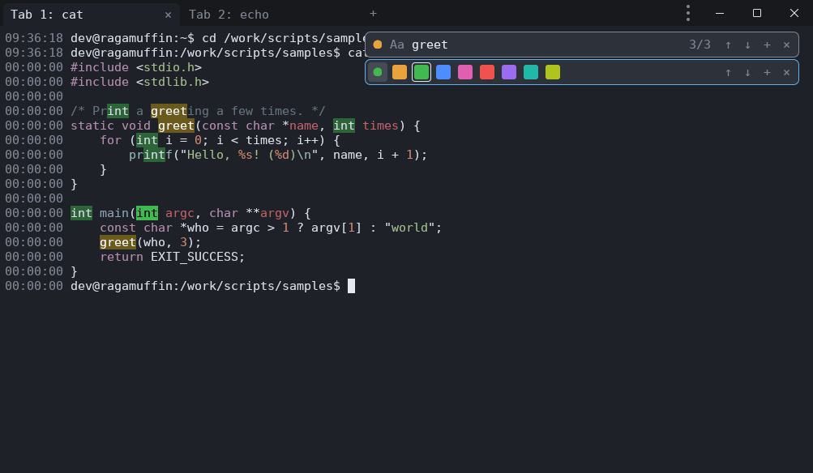
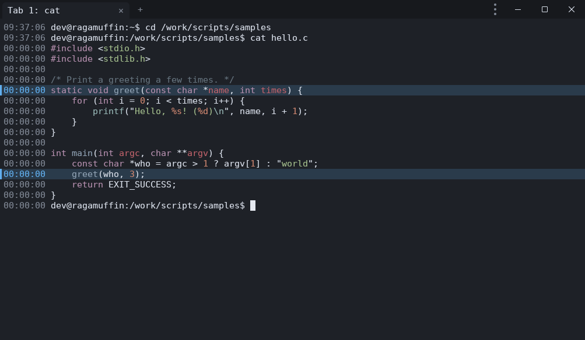
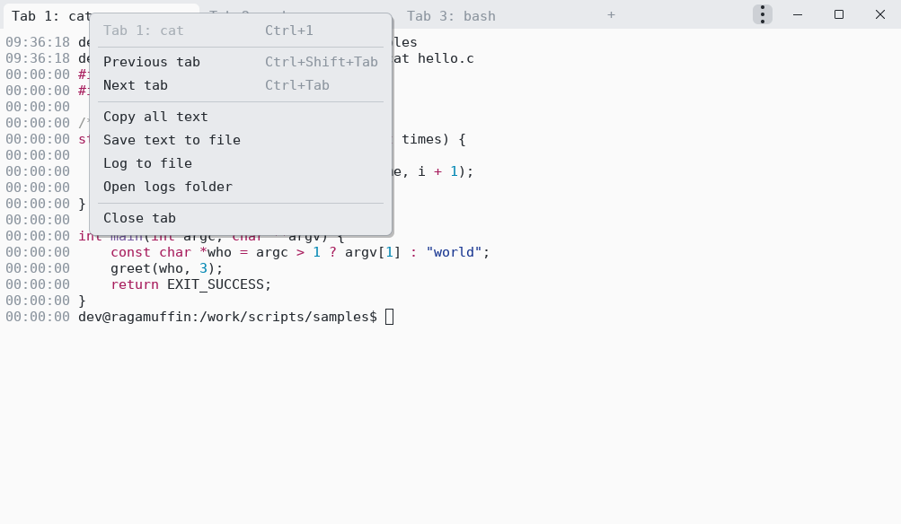
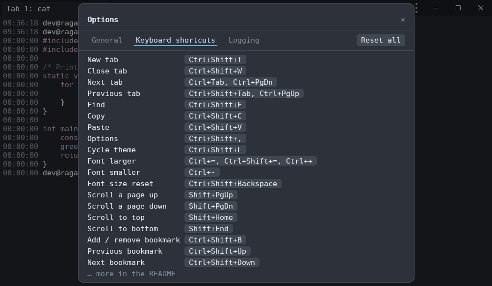
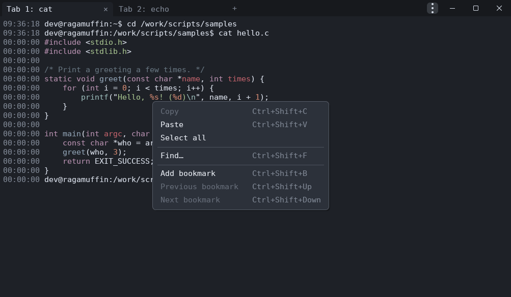

# fastcnsl

[](https://github.com/andrewpushkin/fastcnsl/actions/workflows/build.yml)

A fast terminal for Windows, Linux and macOS. It marks every search match
on screen the way Notepad++ does, colours source code you `cat`, shows when
each line of output appeared, and lets you bookmark lines and log tabs to
files.


## Download

| Platform | Download |
|---|---|
| Windows (x64) | [installer](https://github.com/andrewpushkin/fastcnsl/releases/latest/download/fastcnsl-windows-x86_64-setup.exe) or [portable zip](https://github.com/andrewpushkin/fastcnsl/releases/latest/download/fastcnsl-windows-x86_64.zip) |
| Windows (ARM) | [installer](https://github.com/andrewpushkin/fastcnsl/releases/latest/download/fastcnsl-windows-arm64-setup.exe) or [portable zip](https://github.com/andrewpushkin/fastcnsl/releases/latest/download/fastcnsl-windows-arm64.zip) |
| macOS (Apple Silicon) | [fastcnsl-macos-arm64.dmg](https://github.com/andrewpushkin/fastcnsl/releases/latest/download/fastcnsl-macos-arm64.dmg) |
| Linux: Debian, Ubuntu | [fastcnsl-linux-x86_64.deb](https://github.com/andrewpushkin/fastcnsl/releases/latest/download/fastcnsl-linux-x86_64.deb), or the [apt repository](#debian-ubuntu) for automatic updates |
| Linux: Fedora, RHEL, openSUSE | [fastcnsl-linux-x86_64.rpm](https://github.com/andrewpushkin/fastcnsl/releases/latest/download/fastcnsl-linux-x86_64.rpm), or the [rpm repository](#fedora-rhel) for automatic updates |
| Linux: any distribution | [fastcnsl-linux-x86_64.AppImage](https://github.com/andrewpushkin/fastcnsl/releases/latest/download/fastcnsl-linux-x86_64.AppImage) |

New builds come out often. See [what changed](CHANGELOG.md) or download an
[older build](https://github.com/andrewpushkin/fastcnsl/releases). Each
release lists the SHA-256 of every file in `SHA256SUMS`.

## Install

### Windows

fastcnsl needs Windows 10 version 1809 or newer. Take the x64 or the ARM
download to match your PC (Settings → System → About → System type).

**Installer** (`-setup.exe`): installs for your user only, without asking
for admin rights, into `%LOCALAPPDATA%\Programs\fastcnsl` (choose "all
users" in the first dialog to install into Program Files instead). It
can add fastcnsl to the Start menu, the desktop and PATH. To update, run
a newer installer; it replaces the installed copy and keeps your choices
and settings. Uninstall from Settings → Apps.

**Portable zip**: unzip anywhere and run `fastcnsl.exe`. Settings are kept
in that folder (see [Settings file](#settings-file)), so you can carry it on
a USB stick.

The files aren't code-signed, so the first time Windows may show "Windows
protected your PC". Click **More info**, then **Run anyway**.

Keep the other files next to `fastcnsl.exe`:

- `fastcnsl-wsl` makes WSL tabs faster: `cat` of a 36 MB file takes
  0.33 s, against 0.40 s in Windows Terminal. Windows programs started from
  a WSL tab (`cmd.exe`, `explorer.exe .`) work as usual.
- `conpty.dll` and `OpenConsole.exe` are Microsoft's console host from
  Windows Terminal. With them, large output in cmd and PowerShell tabs is
  about 7 times faster than with the one built into Windows, which
  fastcnsl falls back to if they are missing.

### macOS

Open the `.dmg` and drag `Fastcnsl.app` onto Applications. The app isn't
notarized by Apple, so the first time, right-click it and choose **Open**.

### Linux

Linux builds run on Ubuntu 20.04, Debian 11, Fedora 32 and anything newer.

#### Debian, Ubuntu

Add the apt repository and install, so fastcnsl updates with the rest of
the system:

```sh
curl -fsSL https://andrewpushkin.github.io/fastcnsl/apt/fastcnsl.gpg | sudo tee /usr/share/keyrings/fastcnsl.gpg >/dev/null
curl -fsSL https://andrewpushkin.github.io/fastcnsl/apt/fastcnsl.sources | sudo tee /etc/apt/sources.list.d/fastcnsl.sources >/dev/null
sudo apt update && sudo apt install fastcnsl
```

From then on, `sudo apt update && sudo apt upgrade` installs new builds.

To install the downloaded `.deb` instead, without updates:
`sudo apt install ./fastcnsl-linux-x86_64.deb`.

To remove fastcnsl and the repository:

```sh
sudo apt remove fastcnsl
sudo rm -f /etc/apt/sources.list.d/fastcnsl.sources /usr/share/keyrings/fastcnsl.gpg
```

#### Fedora, RHEL

```sh
sudo curl -fsSL -o /etc/yum.repos.d/fastcnsl.repo https://andrewpushkin.github.io/fastcnsl/rpm/fastcnsl.repo
sudo dnf install fastcnsl
```

dnf asks once to import the repository's signing key; answer `y`. From then
on, `sudo dnf upgrade` installs new builds.

To install the downloaded `.rpm` instead, without updates:
`sudo dnf install ./fastcnsl-linux-x86_64.rpm`.

To remove: `sudo dnf remove fastcnsl && sudo rm /etc/yum.repos.d/fastcnsl.repo`.

#### openSUSE

```sh
sudo zypper addrepo https://andrewpushkin.github.io/fastcnsl/rpm/fastcnsl.repo
sudo zypper refresh
sudo zypper install fastcnsl
```

zypper asks once to trust the signing key; answer `a` (always). From then
on, `sudo zypper update` installs new builds.

To remove: `sudo zypper removerepo fastcnsl && sudo zypper remove fastcnsl`.

#### AppImage (any distribution)

```sh
chmod +x fastcnsl-linux-x86_64.AppImage
./fastcnsl-linux-x86_64.AppImage
```

To keep it updated, use an AppImage manager such as
[Gear Lever](https://flathub.org/apps/it.mijorus.gearlever) or
[AppImageLauncher](https://github.com/TheAssassin/AppImageLauncher), or run
`appimageupdatetool fastcnsl-linux-x86_64.AppImage`
([AppImageUpdate](https://github.com/AppImageCommunity/AppImageUpdate)).
Only the changed parts are downloaded.

## Features

### Search that marks every match

Press **Ctrl+Shift+F** and type. Every match on screen is marked, the current
one stands out, and `3/17` tells you where you are among all matches in the
scrollback. Enter, F3 and the arrow keys move between matches; Ctrl+R
switches to regular expressions. Search ignores case unless you type a
capital letter.

Click **+** in the search bar to add another search below it, up to 8. Each
one gets its own colour, so you can follow several words at once. Click the
dot at the left of a search to choose its colour.



### Code highlighting

When you print a source file with `cat`, `head`, `bat`, `type` (Windows),
`Get-Content` (PowerShell) or `git diff`, fastcnsl colours it. The
language comes from the file name, or from the content (`#!` lines,
`#include`, `fn main`...) when there is no extension. Output a program
colours itself is left as it is. Turn it off in Options if you don't want
it.

### Times beside the output

The left margin shows, for each command, the local time you ran it, and for
each line of its output how long after that it appeared (`HH:MM:SS`). This
makes it easy to see what was slow in a long build or log.

In Options → General you can switch the margin to line numbers counted from
the start of the tab, or turn it off.

### Bookmarks

Right-click a line, or its time, and choose **Add bookmark**, or press
**Ctrl+Shift+B**. The line is tinted and stays marked as more output
arrives. **Ctrl+Shift+↑ / ↓** jump between a tab's bookmarks.



### Tabs

Each tab has its own shell, scrollback and search, and is labelled with the
last program run in it (`Tab 1: vim`). A bell on a tab means it printed
something since you last looked at it, handy for a long build in the
background. Ctrl+1 … Ctrl+9 jump to a tab.

A tab's scrollback has no limit: it keeps everything the tab printed while
the tab is open. Each tab keeps up to 500 MB of its text in memory
(`memory_per_tab_mb`) and older lines in a temporary file in the cache
folder (`~/.cache/fastcnsl/history` on Linux, `%LOCALAPPDATA%\fastcnsl\history`
on Windows, `~/Library/Caches/fastcnsl/history` on macOS). Scrolling,
search, line numbers and bookmarks work the same on those lines. The file
is deleted when the tab closes or fastcnsl exits, even if it crashes.

### Save and log a tab's text

Right-click a tab:

- **Copy all text** puts the tab's text on the clipboard, at most its
  last 100 000 lines.
- **Save text to file** writes the whole scrollback to a `.txt` file.
- **Log to file** writes what the tab already has to a `.log` file, then
  keeps adding lines as they arrive, until you choose **Stop logging** or
  close the tab. A red dot marks a tab that is being logged.
- **Open logs folder** shows where the files go: `fastcnsl-logs` in your
  Documents folder, unless you pick another one.

Files hold plain text as the program printed it, without colours. Options →
Logging can log every new tab automatically and put the time at the start
of each logged line.



### Light and dark themes

fastcnsl follows your system's light or dark setting, including on Linux
desktops (GNOME, KDE and others) and under WSL. You can also pick one in
Options, or press Ctrl+Shift+L to switch.


### Options

Open Options from the **⋮** menu or with **Ctrl+Shift+,**. The General page
sets theme, code highlighting, the time and line number margin and the
graphics mode. The Font page picks the font from the monospace fonts
installed (click one, or step through them with ↑ and ↓) and sets its size,
the line height, whether bold text also turns bright, and on Windows the
text smoothing (ClearType or grayscale). On the Keyboard shortcuts page you
can change any shortcut. Changes take effect at once and are remembered. A
setting you changed has a ↺ next to it that puts back its default.

| General | Keyboard shortcuts |
|---|---|
|  |  |

### Menus

**⋮** in the top-right corner holds new tab, find, copy, paste, Options and
About. Right-click the text for copy, paste, select all and bookmarks.

| ⋮ menu | Right-click menu |
|---|---|
|  |  |

### Fast and light

fastcnsl draws on the GPU (DirectX 12, Metal, Vulkan or OpenGL) and only
redraws when something changes, so it stays responsive with large output.

`cat` of a 32 MiB file, in seconds (lower is better):

| Linux (Ubuntu 26.04) | plain text | colours | Unicode |
|---|---:|---:|---:|
| **fastcnsl** | **0.36** | **0.33** | **0.38** |
| GNOME Terminal | 0.53 | 0.63 | 0.86 |
| Ptyxis | 0.68 | 0.73 | 0.97 |
| Konsole | 1.05 | 0.79 | 0.96 |
| xterm | 1.01 | 1.29 | 1.22 |

| Windows, WSL tab | plain text | colours | Unicode |
|---|---:|---:|---:|
| **fastcnsl** | **0.31** | **0.27** | **0.28** |
| Windows Terminal | 0.35 | 0.88 | 0.71 |
| Classic console (conhost) | 0.56 | 2.16 | 1.23 |

These are medians of 5 runs on a Ryzen 9 7940HX. The
[full results](docs/BENCHMARK.md) include startup time, memory, CPU
use, opening and closing 100 windows, output in 16 tabs at once, cmd and
PowerShell output, and how to run the benchmark yourself.

The title bar is a single row: tabs, ⋮ and the
window buttons share it, leaving more room for text. Drag the empty part of
the bar to move the window, double-click it to maximize.

## Keyboard shortcuts

On macOS, use Cmd where the table says Ctrl+Shift (for example Cmd+T for a
new tab), Cmd+1 … Cmd+0 for tabs, and Cmd+Shift+0 to reset the font size.

| Keys                        | Action                                   |
|-----------------------------|------------------------------------------|
| Ctrl+Shift+T / Ctrl+Shift+W | new tab / close tab                      |
| Ctrl+Tab, Ctrl+PgDn         | next tab (with Shift, or PgUp: previous) |
| Ctrl+1 … Ctrl+9, Ctrl+0     | go to tab 1 … 9, tab 10                  |
| Ctrl+Shift+,                | Options                                  |
| Ctrl+Shift+F                | open or focus search                     |
| Enter / Shift+Enter, F3     | previous (older) / next match            |
| ↑ / ↓ in search             | previous / next match                    |
| Ctrl+R in search            | toggle regular expressions               |
| Tab / Shift+Tab in search   | next / previous search box               |
| Esc in search               | close search (all boxes)                 |
| Ctrl+Shift+C / Ctrl+Shift+V | copy / paste                             |
| Ctrl+= / Ctrl+- / Ctrl+Shift+Backspace | larger / smaller / default font |
| Ctrl+Shift+L                | cycle theme: system → dark → light       |
| Shift+PgUp / PgDn / Home / End | scroll the scrollback                 |
| Ctrl+Shift+B                | add / remove bookmark                    |
| Ctrl+Shift+↑ / ↓            | previous / next bookmark                 |

**Changing shortcuts.** In Options → Keyboard shortcuts, click a command's
keys and press the new ones. Esc cancels, Backspace removes the shortcut,
↺ restores that command's default, and Reset all restores every default. A
key taken from another command is removed there. The keys inside search
(Enter, F3, Ctrl+R, Tab, Esc), the tab number keys and the mouse can't be
changed.

**Mouse.** Drag to select, double-click to select a word, triple-click for a
line. Right-click opens the copy, paste and bookmark menu; middle-click
pastes. On a tab, middle-click closes it and right-click opens the tab
menu. Hold Shift to select text in programs that use the mouse themselves
(vim, htop).

## Settings file

Everything in Options is saved to a settings file, created on first start.
**Options → Open config.toml** opens it. It lives at:

- Windows: `%APPDATA%\fastcnsl\config.toml`
- Windows, portable zip: `config.toml` next to `fastcnsl.exe`, as long as
  the file `portable` is there (delete it to use `%APPDATA%`). On first
  start it begins with a copy of your `%APPDATA%` settings, if you have any
- macOS: `~/Library/Application Support/fastcnsl/config.toml`
- Linux: `~/.config/fastcnsl/config.toml`

Changes you save there apply immediately. To use a different file, set the
`FASTCNSL_CONFIG` environment variable to its path. All settings with
their defaults:

```toml
font_family = "JetBrains Mono"   # any installed font
font_size = 11.0                 # points
line_height = 1.2
theme = "system"                 # "system" | "dark" | "light"
shell = ""                       # empty: $SHELL, or PowerShell/cmd on Windows
shell_args = []
memory_per_tab_mb = 500          # RAM per tab for its text; older lines go to a temporary file
ui_idle_opacity = 0.4            # scrollbar/search bar opacity when not in use
padding = 6.0
code_highlight = true
line_numbers = "command"         # "command" (times per command) | "tab" (line numbers) | "off"
code_theme_dark = "base16-ocean.dark"
code_theme_light = "InspiredGitHub"
bold_is_bright = false
title_bar = "custom"             # "custom" (one row with the tabs) | "system" (OS title bar)
display_backend = "auto"         # Linux: "auto" | "wayland" | "x11" (restart to apply)
antialiasing = "auto"            # "auto" | "subpixel" | "grayscale"
minimum_contrast = 4.5           # text on coloured backgrounds: WCAG contrast ratio, 1 = off
gpu = "auto"                     # "auto" | "directx" | "vulkan" | "opengl" | "metal" | "software"
wsl_direct = true                # Windows: WSL tabs through fastcnsl-wsl (false: console host)
log_folder = ""                  # empty: fastcnsl-logs in Documents (or home)
log_new_tabs = false             # log every new tab to a file
log_timestamps = false           # start each logged line with [HH:MM:SS]
```

Code themes: `base16-ocean.dark`, `base16-eighties.dark`, `base16-mocha.dark`,
`base16-ocean.light`, `InspiredGitHub`, `Solarized (dark)`, `Solarized (light)`.

Changed shortcuts are saved in a `[keys]` table that lists only what
differs from the defaults:

```toml
[keys]
new_tab = "Ctrl+T"
next_tab = "Ctrl+Tab, Alt+Right"   # several keys: comma-separated
find = ""                          # no shortcut
```

Command names: `new_tab`, `close_tab`, `next_tab`, `previous_tab`, `find`,
`copy`, `paste`, `options`, `cycle_theme`, `font_bigger`, `font_smaller`,
`font_reset`, `scroll_page_up`, `scroll_page_down`, `scroll_top`,
`scroll_bottom`, `toggle_bookmark`, `previous_bookmark`, `next_bookmark`.
Modifiers: `Ctrl`, `Shift`, `Alt`, `Cmd` (or `Win`). Keys: a character,
`Tab`, `Enter`, `Space`, `PageUp`, `PageDown`, `Home`, `End`,
`Up`/`Down`/`Left`/`Right`, `F1`–`F12`, and similar.

**Text** is drawn by FreeType on every platform, the way wezterm draws it:
hinted at normal DPI, unhinted on high-DPI screens, and blended without
gamma correction. On Windows, `antialiasing = "auto"` follows the system:
sub-pixel (LCD) text when "Adjust ClearType text" is on, grayscale
otherwise.

## Command line

The `fastcnsl` command can also open and close tabs in a window that is
already running, which is useful in scripts:

```text
fastcnsl [--gpu API]
fastcnsl [--pid N] new-tab [NAME] [-- COMMAND ARGS...]
fastcnsl [--pid N] close-tab [NAME | NUMBER]
fastcnsl [--pid N] quit
fastcnsl --help
fastcnsl -V | --version
```

| Command | What it does |
|---|---|
| `new-tab` | Opens a tab with your shell. If no window is running, starts one. |
| `new-tab NAME` | The tab's label reads `Tab N: NAME` instead of the program name. |
| `new-tab NAME -- COMMAND ARGS...` | Runs `COMMAND` in the tab instead of the shell; the tab closes when it exits. |
| `close-tab` | Closes the active tab. |
| `close-tab NAME` | Closes the tab with that name (or, failing that, running that program). |
| `close-tab 2` | Closes the second tab. |
| `quit` | Closes the window and all its tabs. |

Examples:

```sh
fastcnsl new-tab logs -- tail -f /var/log/syslog
fastcnsl new-tab build -- cargo watch -x test
fastcnsl close-tab logs
```

```powershell
fastcnsl new-tab dev -- powershell -NoExit -Command "cd C:\src\app"
fastcnsl new-tab cmd -- cmd /k echo hello
```

Commands go to the most recently started window; `--pid N` picks one by
process id. A command prints a short reply (`opened tab 2`, `closed Tab 1:
logs`) and exits with 0. Errors (`no tab named x`, `no window is running`)
exit with 1, wrong usage with 2. Only you can control your windows: each
command must present a secret that only your user account can read.

On Windows, `fastcnsl.exe` is a GUI program, so cmd and PowerShell don't
wait for it and the reply appears after the prompt. To wait for it in a
PowerShell script and check `$LASTEXITCODE`, pipe its output:

```powershell
fastcnsl quit 2>&1 | Out-Host
if ($LASTEXITCODE -ne 0) { "no window to close" }
```

From WSL it behaves like any Linux command.

## Troubleshooting

**The window is blank, or fastcnsl doesn't start on a VM or remote
desktop.** Choose Software in Options → General → Graphics, or start it once
with `fastcnsl --gpu software`. It then draws without the GPU. If the
graphics mode you chose isn't available, fastcnsl falls back to the
automatic choice; About shows what is in use.

**macOS says the app can't be opened.** Right-click `Fastcnsl.app` and
choose Open. This is needed only the first time.

**The mouse pointer is hidden over the window under WSLg** (Linux apps on
Windows) until you click. That is WSLg behaviour and affects other Linux
apps too. Use the Windows build instead, which also handles WSL tabs.

## Building from source

See [docs/DEVELOPMENT.md](docs/DEVELOPMENT.md).

## License

MIT, see [LICENSE](LICENSE).
